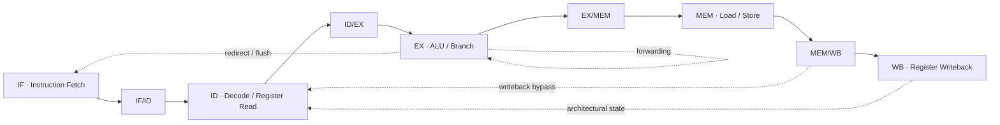

# 5-Stage RV32I RISC-V Processor
**CPU Microarchitecture · RTL Design · Pipeline Control · Verification**

An educational SystemVerilog RTL implementation of a 32-bit, five-stage, in-order RISC-V processor, with a UVM testbench and instruction-level reference checking. The design focuses on the CPU datapath and control path: instruction decode, ALU execution, register-file updates, load/store operations, branches and jumps, data forwarding, and load-use interlocks.

> **Implementation status:** The checked-in RTL implements an RV32I instruction subset. The current baseline does not implement clock gating, DVFS, power gating, retention, UPF power intent, or measured power optimization. Those are documented below as future architecture extensions, not existing features.

## At a glance

| Area | Implementation |
|---|---|
| Architecture | 32-bit, five-stage, in-order pipeline |
| Pipeline | IF → ID → EX → MEM → WB |
| ISA scope | RV32I instruction subset (see supported operations below) |
| Register file | 32 × 32-bit; `x0` hardwired to zero |
| Memories | Internal instruction and data memories; 1,024 × 32-bit words each by default |
| Pipeline control | Data forwarding, load-use stall, branch/jump redirect and flush |
| RTL | SystemVerilog |
| Verification | UVM, SVA, functional coverage, architectural scoreboard |
| Simulator | QuestaSim / EDA Playground |
| Regression evidence | 20/20 seeds passed; 800 committed instructions checked; 0 scoreboard mismatches |

## 1. CPU microarchitecture

The processor is divided into five pipeline stages. Pipeline registers carry instruction, operand, destination, and control information between stages. Valid bits identify active entries as instructions advance through the pipeline.

### Pipeline organization



### Stage responsibilities

| Stage | Microarchitectural responsibility |
|---|---|
| **IF — Fetch** | Uses the program counter to read the internal instruction memory. Supports instruction preloading through the `instr_load_*` interface. |
| **ID — Decode** | Extracts opcode and register fields, generates I/S/B/U/J immediates, reads the register file, and generates control signals. |
| **EX — Execute** | Selects operands, performs ALU operations, evaluates branch conditions, and calculates branch/jump targets and effective memory addresses. |
| **MEM — Memory** | Performs word-oriented data-memory reads and writes using the calculated address. |
| **WB — Writeback** | Selects the result returned to the architectural register file. Commit/debug outputs expose the instruction and writeback event. |

### Datapath elements

- 32-bit program counter and instruction path.
- 32-entry, 32-bit architectural register file; writes to `x0` are suppressed and `x0` is held at zero.
- ALU operations: add, subtract, AND, OR, XOR, logical/arithmetic shifts, and signed/unsigned comparisons.
- Immediate-generation paths for I-, S-, B-, U-, and J-type instruction formats.
- Internal instruction memory and word-addressed data memory.
- Pipeline registers: IF/ID, ID/EX, EX/MEM, and MEM/WB.
- Commit/debug signals for observing architectural instruction completion.

### Implemented instruction subset

The current RTL and reference model include the following instruction groups:

| Group | Implemented operations |
|---|---|
| R-type | ADD, SUB, AND, OR, XOR, SLL, SRL, SRA, SLT, SLTU |
| I-type ALU | ADDI, ANDI, ORI, XORI, SLTI, SLTIU, SLLI, SRLI, SRAI |
| Load/store | LW and SW word paths |
| Conditional branches | BEQ, BNE, BLT, BGE, BLTU, BGEU |
| Upper-immediate | LUI, AUIPC |
| Jumps | JAL, JALR |

This is an implemented instruction subset, not a claim of full RV32I compliance or a RISC-V architectural certification result.

## 2. Pipeline control and hazard handling

### Data forwarding

The datapath includes forwarding paths so dependent instructions can consume the newest available producer value without waiting for every result to reach the register file.

- EX/MEM-to-EX forwarding for eligible ALU results.
- MEM/WB-to-EX forwarding for completed writeback results.
- Decode-stage bypassing from visible pipeline producers and writeback.
- Youngest-writer priority when more than one in-flight instruction targets the same source register.

### Load-use interlock

A load result is not forwarded from EX/MEM before the data-memory read is available. The hazard logic detects dependent source-register use and stalls the front of the pipeline when required. During a stall, the PC and IF/ID contents are held and a bubble is inserted into the next stage.

### Control-flow handling

Taken branches, JAL, and JALR redirect the program counter. The instruction in IF/ID is invalidated on a redirect to prevent the sequentially fetched instruction from being treated as a valid instruction.

## 3. Verification architecture

The checked-in EDA Playground testbench is organized around a UVM agent, instruction sequences, commit monitoring, a scoreboard, functional coverage, and SVA.

| Testbench element | Responsibility |
|---|---|
| Sequence item | Represents an encoded RV32I instruction. |
| Sequencer and driver | Generate directed or constrained-random instruction streams and load the instruction memory. |
| Monitor | Observes commit and writeback activity. |
| Scoreboard | Compares committed DUT behavior with the reference architectural model. |
| Coverage subscriber | Samples instruction opcode, function fields, register usage, and memory/register write activity. |
| SVA module | Checks key pipeline-control and architectural invariants. |
| Test classes | Run base, hazard, branch, and randomized instruction scenarios. |

### Reference-model implementation note

The **checked-in EDA Playground testbench uses a SystemVerilog-only architectural reference model inside the UVM scoreboard**. A C++ DPI-C reference model is not included in the current public repository snapshot. Do not treat DPI-C integration as part of this checked-in build unless the C++ source and DPI import/build flow are added.

### Directed and randomized scenarios

| Test | Focus |
|---|---|
| `base_test` | Basic ALU and pipeline sanity sequence |
| `hazard_test` | RAW dependencies and forwarding/interlock behavior |
| `branch_test` | Branch conditions, redirects, and flush behavior |
| `random_instruction_test` | Constrained-random R-type, I-type, load, and store instruction stream |

### Assertion checks

The current SVA module checks:

- No architectural write to register `x0`.
- PC stability while a load-use stall is asserted.
- IF/ID PC and instruction stability during a stall.
- Sequential PC increment when there is no stall or taken branch.
- Known writeback data for valid register writes.

## 4. Regression results

The final documented run uses QuestaSim on EDA Playground, final RTL version **v7**, and `random_instruction_test`.

| Metric | Result |
|---|---:|
| Random seeds completed | 20 / 20 |
| Seeds passed | 20 |
| Committed instructions checked | 800 (40 per seed) |
| Scoreboard mismatches | 0 |
| UVM errors | 0 |
| UVM fatals | 0 |
| Functional coverage range | 55.73%–59.51% |
| Average observed functional coverage | 58.38% |

Coverage is the functional instruction coverage collected by the testbench. These results do not represent 100% functional coverage, code coverage closure, formal proof, gate-level signoff, or industrial silicon signoff.

Per-seed results are available in [`reports/regression_results.csv`](reports/regression_results.csv) and [`docs/REGRESSION_EVIDENCE.md`](docs/REGRESSION_EVIDENCE.md).

## 5. Debug case study: youngest-writer forwarding

Constrained-random seed 10 exposed a RAW dependency corner case involving consecutive writes to the same destination register followed by an immediate consumer.

**Failing dependency pattern**

```text
instruction[6]  writes x7
instruction[7]  writes x7
instruction[8]  reads  x7
```

The consumer must observe the value from the youngest producer. Earlier RTL versions selected a stale value in this bypass case, producing a scoreboard mismatch.

**Correction in v7**

- Corrected forwarding priority so the youngest matching producer takes precedence.
- Added decode-stage bypass handling for the corner case.
- Re-ran seed 10 and the full 20-seed regression.

**Final recorded result:** seed 10 passed with 40 committed instructions checked, zero UVM errors, and zero UVM fatals. The full v7 regression passed all 20 seeds with zero scoreboard mismatches. See [`docs/DEBUG_NOTES.md`](docs/DEBUG_NOTES.md).

## 6. Repository layout

```text
riscv-pipeline-verification/
├── docs/
│   ├── DEBUG_NOTES.md
│   ├── REGRESSION_EVIDENCE.md
│   └── SIGNOFF_SUMMARY.md
├── eda_playground/
│   ├── README_EDA.txt
│   ├── design.sv
│   └── testbench.sv
├── logs/
│   └── README.md
├── reports/
│   └── regression_results.csv
├── scripts/
│   └── run_options.txt
├── .gitignore
└── README.md
```

The EDA Playground version is intentionally packaged as two files: `design.sv` and `testbench.sv`.

## 7. Run the simulation

### EDA Playground

1. Open [EDA Playground](https://www.edaplayground.com/).
2. Paste `eda_playground/design.sv` into the Design pane.
3. Paste `eda_playground/testbench.sv` into the Testbench pane.
4. Select SystemVerilog, UVM methodology, and Mentor Questa.
5. Set the top-level module to `tb_top`.
6. Start with `+UVM_TESTNAME=base_test`; then run `hazard_test`, `branch_test`, and `random_instruction_test`.

### QuestaSim command-line example

From the `eda_playground` directory:

```bash
qrun -batch -access=rw+/. -uvmhome uvm-1.2 \\
  -timescale 1ns/1ns -mfcu design.sv testbench.sv \\
  +UVM_TESTNAME=random_instruction_test -sv_seed 10 \\
  -do "run -all; exit"
```

The command assumes a QuestaSim installation with UVM 1.2 available. The seed list used for the recorded regression is in [`scripts/run_options.txt`](scripts/run_options.txt).

## 8. Low-Power CPU Extension

The optional low_power/riscv_pipeline_lp.sv wrapper integrates a power controller around the existing five-stage CPU.

Implemented control behavior:

- RUN, DRAIN, IDLE, SLEEP, and WAKEUP operating states.
- Fetch quiescence during DRAIN so no new instructions enter while valid pipeline entries retire.
- IDLE/SLEEP entry only after pipeline_empty and memory_idle are both asserted.
- Latch-based integrated clock-gating simulation model for the CPU clock.
- Retention-save / retention-restore request pulses and parameterized wake-up latency.
- Instruction-memory preload is treated as a wake event so a gated core can be initialized.

Run the low-power integration test from the repository root:

```bash
make -C low_power test
```

The original UVM baseline ties quiesce_req low and retains its existing clocking behavior. The optional wrapper is the low-power integration path.

The ICG model must be replaced by a characterized library clock-gating cell for implementation. The memory_idle signal must be driven by the real memory/interconnect outstanding-transaction status. Retention outputs are control hooks; this repository does not instantiate retention flops, power switches, or UPF power intent.

## 9. Current Scope and Limitations

- Educational five-stage RV32I-subset RTL; not a complete ISA compliance implementation.
- Internal word-oriented instruction/data memories; no external cache hierarchy or coherent interconnect.
- The optional wrapper implements clock gating and power-state sequencing at the RTL control level; no power gating, DVFS, UPF domains, isolation cells, or retention cells are implemented.
- No measured silicon power, characterized post-layout power, or quantified power reduction.
- No documented synthesis/PPA, gate-level/SDF, formal-proof, or full-chip signoff result.
- The public EDA Playground UVM testbench uses a SystemVerilog reference model; C++ DPI-C integration is not included in this repository snapshot.

## Project takeaway

This project provides a five-stage CPU datapath and control implementation, explicit forwarding and load-use interlock behavior, branch/jump redirect handling, a UVM-based verification environment, assertion checks, and recorded multi-seed regression evidence. The next milestones are UPF/retention-cell integration and library-based activity/power characterization; no physical power reduction is claimed by the current RTL extension.


## Low-Power CPU Architecture Extension

An integrated low-power wrapper is now available under low_power/. It adds RUN/DRAIN/IDLE/SLEEP/WAKEUP control, stops new instruction fetches during drain, waits for both pipeline and memory quiescence, and gates the CPU clock through a latch-based ICG model. The wrapper exposes retention-save/restore requests and a configurable wake-up interval.

Run the self-checking integration test with make -C low_power test. This extension is additive; the original UVM baseline remains available. The ICG is a simulation model that must be replaced by a characterized library cell for implementation. No measured power reduction or silicon-level result is claimed.
